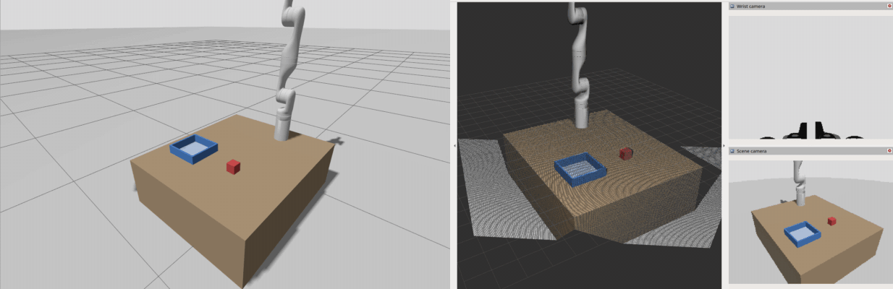

# Kinova Gen3 pick and place in Gazebo

[](https://docs.ros.org/en/jazzy/)
[](https://gazebosim.org/docs/harmonic/)
[](https://releases.ubuntu.com/24.04/)
[](https://github.com/moveit/moveit2)
[](LICENSE)

A pick-and-place lab for a university robotics course, built on ROS 2 Jazzy, Gazebo Harmonic and
MoveIt 2. A simulated Kinova Gen3 7-DoF arm with a Robotiq 2F-85 gripper stands on a table with a
red cube, a blue basket and two RGB-D cameras. Students complete a C++ MoveIt node that picks the
cube and leaves it in the basket. The setup targets Ubuntu 24.04 PCs with a native ROS install.



Expected result at 1.5x speed. [Full video at real speed (MP4)](docs/demo.mp4).

## Contents

- [Requirements](#requirements)
- [Installation](#installation)
- [Quick start](#quick-start)
- [The exercise](#the-exercise)
- [Repository layout](#repository-layout)
- [Simulation details](#simulation-details)
- [Troubleshooting](#troubleshooting)
- [Using the real robot](#using-the-real-robot)
- [Acknowledgements](#acknowledgements)
- [License](#license)

## Requirements

- Ubuntu 24.04 with `sudo` rights.
- ROS 2 Jazzy installed from apt, following the
  [official guide](https://docs.ros.org/en/jazzy/Installation/Ubuntu-Install-Debs.html), with
  `ros-dev-tools` (colcon) and `/opt/ros/jazzy/setup.bash` sourced in every terminal.
- `git`.

Gazebo Harmonic, the version paired with Jazzy, comes with `ros-jazzy-ros-gz` in step 1.

## Installation

### 1. Install the dependencies

MoveIt 2, the ros2_control controllers, Kinova's Gen3 description and MoveIt configuration, and the
Gazebo integration (`ros_gz`, `gz_ros2_control`) are installed as binary packages.

```bash
sudo apt update
sudo apt install ros-jazzy-moveit ros-jazzy-ros2-controllers ros-jazzy-rmw-cyclonedds-cpp \
  ros-jazzy-kinova-gen3-7dof-robotiq-2f-85-moveit-config ros-jazzy-kortex-description \
  ros-jazzy-ros-gz ros-jazzy-gz-ros2-control ros-jazzy-ros2controlcli
```

### 2. Configure ROS 2 and Gazebo

- `RMW_IMPLEMENTATION` selects Cyclone DDS, the ROS 2 middleware this lab was tested with.
- On a shared lab network, ROS 2 and Gazebo find each other across PCs, so you would see your
  classmates' robots. `ROS_AUTOMATIC_DISCOVERY_RANGE` limits ROS 2 discovery to localhost, and
  `GZ_IP` makes Gazebo use the loopback interface.

```bash
echo 'export RMW_IMPLEMENTATION=rmw_cyclonedds_cpp' >> ~/.bashrc
echo 'export ROS_AUTOMATIC_DISCOVERY_RANGE=LOCALHOST' >> ~/.bashrc
echo 'export GZ_IP=127.0.0.1' >> ~/.bashrc
```

Open a new terminal afterwards so the variables take effect, and check them:

```bash
printenv | grep -E 'RMW_IMPLEMENTATION|ROS_AUTOMATIC_DISCOVERY_RANGE|GZ_IP'
```

Terminals opened before this step keep the old values: close them.

### 3. Create the workspace and clone

Packages of a colcon workspace go in its `src` folder.

```bash
mkdir -p ~/kinova_ws/src
cd ~/kinova_ws/src
git clone https://github.com/Gruzver/kinova-gazebo.git
```

### 4. Build

apt also installs `robotiq_description`, as a dependency of `kortex_description`. This repository
ships a newer copy, and colcon warns when a workspace package overrides one in `/opt/ros/jazzy`.
`--allow-overriding` states that the override is intended.

```bash
cd ~/kinova_ws
colcon build --allow-overriding robotiq_description
```

## Quick start

Open two terminals.

```bash
# Terminal 1: Gazebo + robot + cube + MoveIt + RViz
source ~/kinova_ws/install/setup.bash
ros2 launch kinova_gazebo_bringup sim.launch.py

# Terminal 2: your node
source ~/kinova_ws/install/setup.bash
ros2 run kinova_pick_place pick_place
```

What you should see:

- Gazebo opens with the table, the cube, the basket and the arm standing upright.
- RViz opens once `joint_state_broadcaster` is running. The 3D view shows the robot and the point
  clouds of both cameras. The wrist and scene camera images are on the right. On the left, the
  Displays panel turns each display on or off (`Wrist axes` and `Scene axes` show the camera
  frames). The `MotionPlanning` display is off; enable it to plan by hand.
- Before you complete the exercise, `pick_place` moves the arm to `Home`, opens the gripper, stops
  above the cube and exits.

To start over, stop terminal 1 (Ctrl+C) and launch it again: the cube goes back to its place.

## The exercise

Complete [`kinova_pick_place/src/pick_place.cpp`](kinova_pick_place/src/pick_place.cpp) so that the
arm picks the cube and leaves it in the basket.

The file already contains:

- constants for the cube and basket positions, the grasp height and the gripper orientation;
- the helpers `make_pose()`, `plan_and_execute()` and `move_line()`;
- the motion to `Home`, opening the gripper, and step 1 (above the cube).

The helpers use the same MoveIt API as the course's Panda MoveIt lab (`go_to_pose`,
`draw_square`). Steps 2 to 7 are marked `TODO` in the file:

2. go straight down to `kGraspZ` with `move_line()`
3. close the gripper with the named target `"Close"`
4. lift the cube straight up by `kAbove`
5. move above the place spot (`kPlaceX`, `kPlaceY`)
6. go down to `kGraspZ + 0.005` and open the gripper
7. leave straight up, then go to the named target `"Home"`

After each edit, rebuild and run again from terminal 2:

```bash
cd ~/kinova_ws
colcon build --packages-select kinova_pick_place
ros2 run kinova_pick_place pick_place
```

Terminal 1 can stay open while you rebuild. If the cube has moved, restart terminal 1 to put it
back.

The exercise is complete when:

- the cube ends inside the blue basket and the arm returns to `Home`;
- terminal 2 prints `Done: <step>` for every step, with no `Planning failed`, `Execution failed` or
  `Only N % of the line` errors;
- terminal 1 prints `Object detected: cube grasped` when the gripper closes and `Cube released`
  when it opens.

## Repository layout

```text
kinova-gazebo/
├── kinova_gazebo_bringup/          Simulation: world, robot, cameras, controllers, MoveIt, RViz
│   ├── config/
│   │   ├── gen3.srdf               MoveIt planning groups and named states
│   │   ├── moveit_controllers.yaml Controllers that MoveIt sends trajectories to
│   │   ├── ros2_controllers.yaml   ros2_control controllers running in Gazebo
│   │   └── sim.rviz                RViz layout: 3D view, point clouds, camera images
│   ├── launch/
│   │   ├── sim.launch.py           Entry point: Gazebo, robot, bridge, controllers, grasp helper, MoveIt
│   │   └── moveit.launch.py        move_group and RViz, included by sim.launch.py
│   ├── models/
│   │   ├── cube.sdf                Same cube as in the world, to spawn extra cubes
│   │   └── scene_camera.sdf        Fixed RGB-D camera
│   ├── scripts/grasp_fix.py        Grasp helper node
│   └── worlds/pick_place.sdf       Table, cube and basket
├── kinova_pick_place/
│   └── src/pick_place.cpp          Exercise skeleton
├── robotiq_description/            Robotiq gripper description, vendored from PickNik
├── docs/                           Demo GIF and video
├── LICENSE                         BSD-3-Clause
└── LICENSE-APACHE                  Apache-2.0, for the files derived from ros2_kortex launch files
```

## Simulation details

### World

The world is [`worlds/pick_place.sdf`](kinova_gazebo_bringup/worlds/pick_place.sdf). The robot base
is spawned on the table top, 0.30 m above the Gazebo origin. In TF, `world` is the robot base
(`base_link`); positions below are in `base_link`, where the table surface is z = 0.

| Object | Position in `base_link` (m) | Notes |
|---|---|---|
| Table surface | z = 0 | 0.95 x 0.80 m, centred at (0.325, -0.10) |
| Red cube | centre (0.50, 0.00, 0.025) | 5 cm, 50 g |
| Blue basket (place spot) | centre (0.50, -0.30) | 18 cm inside, 5 cm high; no floor, the cube rests on the table |

Gazebo runs the Bullet Featherstone physics engine with a 1 ms step. `models/cube.sdf` is the same
cube; its header shows how to spawn another one. Only the model named `cube` can be grasped (see
[Grasp helper](#grasp-helper)).

### Robot and MoveIt

- Robot: Gen3 7-DoF with the vision module and a Robotiq 2F-85, from `kortex_description`. The arm
  starts with all joints at 0 (upright).
- `sim.launch.py` changes the stock model: knuckle effort limit 5 instead of 50 (the default crushes
  the cube), wrist camera at 320x240 and 10 Hz with depth from 0.15 m, and a detachable joint for the
  grasp helper.
- Controllers: `joint_trajectory_controller` (arm), `robotiq_gripper_controller` (gripper) and
  `joint_state_broadcaster`.
- Planning groups: `manipulator` (arm, tip `end_effector_link`) and `gripper`.
- Named states: `Home`, `Retract`, `Vertical` (arm); `Open`, `Close` (gripper). The exercise uses
  `Home`, `Open` and `Close`.
- `Home`: gripper pointing down, `end_effector_link` at about (0.40, -0.025, 0.30).
- Gripper pointing down: roll = π, pitch = 0, yaw = π (as in `Home`). The fingers close along x.
- Planning pipelines: OMPL and the Pilz industrial motion planner.

### Cameras

| | Wrist camera | Scene camera |
|---|---|---|
| Mount | Gen3 vision module, looks where the gripper points | Fixed at (1.25, -0.75, 0.65) in `world`, looks at the table |
| Topic prefix | `/wrist_mounted_camera` | `/scene_camera` |
| Frame | `camera_color_frame` | `scene_camera` |
| Resolution, rate | 320x240, 10 Hz | 320x240, 5 Hz |
| Horizontal field of view | 1.047 rad | 1.047 rad |
| Depth range | 0.15 to 5 m | 0.1 to 2 m |

Each camera publishes four topics under its prefix:

| Topic | Type | Content |
|---|---|---|
| `<prefix>/image` | `sensor_msgs/msg/Image` | Color image |
| `<prefix>/depth_image` | `sensor_msgs/msg/Image` | Depth in metres |
| `<prefix>/points` | `sensor_msgs/msg/PointCloud2` | Colored point cloud |
| `<prefix>/camera_info` | `sensor_msgs/msg/CameraInfo` | Camera intrinsics |

Both frames have x forward, along the camera view.

### Grasp helper

[`scripts/grasp_fix.py`](kinova_gazebo_bringup/scripts/grasp_fix.py) (node `grasp_fix`) holds the
cube firmly once the gripper closes on it, as `gazebo_grasp_fix` did in Gazebo Classic. It also
reports the grasp, like the object detection of the real Robotiq gripper.

1. It reads the left knuckle joint from `/joint_states` and the cube pose from `/model/cube/pose`.
2. When the fingers stop part way while closing, with the cube centre within 5 cm of the midpoint
   of the fingertips, it publishes `/gripper/attach`. Gazebo's DetachableJoint system then fixes the
   cube to `bracelet_link`, and terminal 1 prints `Object detected: cube grasped`.
3. When the gripper opens again, it publishes `/gripper/detach`, the cube is released, and terminal
   1 prints `Cube released`.

The detachable joint attaches the cube when the robot is spawned, so `sim.launch.py` sends detach
messages for a few seconds at startup.

| Topic | Type | Use |
|---|---|---|
| `/gripper/object_detected` | `std_msgs/msg/Bool` | `true` while the cube is held; latched (transient local) |
| `/gripper/attach`, `/gripper/detach` | `std_msgs/msg/Empty` | ROS to Gazebo: fix or release the cube |
| `/model/cube/pose` | `geometry_msgs/msg/PoseStamped` | Gazebo to ROS: cube pose in the Gazebo world frame |

Parameters: `base_z` (height of `base_link` in Gazebo, 0.3, set by the launch file) and
`max_distance` (cube centre to fingertip midpoint, default 0.05 m).

### Launch arguments

`sim.launch.py` takes one argument:

| Argument | Default | Description |
|---|---|---|
| `launch_rviz` | `true` | Start RViz |

```bash
ros2 launch kinova_gazebo_bringup sim.launch.py launch_rviz:=false
```

## Troubleshooting

| Symptom | Fix |
|---|---|
| `Package 'kinova_gazebo_bringup' not found` | Run `source ~/kinova_ws/install/setup.bash` in that terminal. |
| Your classmates' robots appear | The isolation variables are not set: check `~/.bashrc` ([step 2](#2-configure-ros-2-and-gazebo)) and open a new terminal. |
| `pick_place` cannot connect to `move_group`, or a terminal does not see the other terminal's nodes | Both terminals need the same three variables from [step 2](#2-configure-ros-2-and-gazebo). Check them with `printenv` in each terminal; close terminals opened before step 2. |
| `ros2 topic list` shows old or no topics after you changed `~/.bashrc` | The ROS 2 daemon still uses the old settings: run `ros2 daemon stop`, then the command again. |
| colcon warns that `robotiq_description` is already built in `/opt/ros/jazzy` | Build with `--allow-overriding robotiq_description` ([step 4](#4-build)). |
| `Planning failed` | The pose is out of reach or in collision: check x, y, z. |
| `Only N % of the line` | The straight line is not reachable: move the points closer to (0.5, 0, 0.2). |
| No `Object detected` after closing | The fingers did not close around the cube: check x, y and `kGraspZ`. |
| The cube is out of place | Stop terminal 1 (Ctrl+C) and launch it again. |
| `No 3D sensor plugin(s) defined for octomap updates` or `/recognize_objects not available` | Normal, no action needed. |

## Using the real robot

This repository covers the simulation only. It has no launch file or configuration for the real
arm.

The exercise node does not use Gazebo: it talks to MoveIt (`move_group`) through
`MoveGroupInterface`. Kinova's [ros2_kortex](https://github.com/Kinovarobotics/ros2_kortex)
provides the driver and a MoveIt launch file for the real Gen3 (`robot.launch.py` in
`kinova_gen3_7dof_robotiq_2f_85_moveit_config`, with a `robot_ip` argument). With those running
instead of `sim.launch.py`, the same node can drive the real arm. Follow the ros2_kortex
documentation to install and start them; the apt line in [step 1](#1-install-the-dependencies) does
not list the driver.

Differences to check first:

- Kinova's MoveIt configuration uses its own SRDF. It has the same planning groups, and `Home`,
  `Open` and `Close` exist with different joint values (Kinova's `Home` has `joint_3` at 3.14).
- The constants in `pick_place.cpp` describe the simulated scene. Measure the real positions in
  `base_link`.
- The grasp helper and `/gripper/object_detected` exist only in the simulation.
- The isolation variables keep ROS 2 traffic on one PC. Remove them from `~/.bashrc` if the driver,
  MoveIt and your node run on different computers. `GZ_IP` affects only Gazebo.

## Acknowledgements

- [Kinovarobotics/ros2_kortex](https://github.com/Kinovarobotics/ros2_kortex): `kortex_description`
  and `kinova_gen3_7dof_robotiq_2f_85_moveit_config`, used from the Jazzy binaries (0.2.6). The
  launch files and configuration in `kinova_gazebo_bringup` are based on ros2_kortex files (see
  [License](#license)).
- [PickNikRobotics/ros2_robotiq_gripper](https://github.com/PickNikRobotics/ros2_robotiq_gripper):
  `robotiq_description` is an unmodified copy of commit `a74d007`, with the upstream BSD-3-Clause
  license in `robotiq_description/LICENSE`.
- [ros_gz](https://github.com/gazebosim/ros_gz): starts Gazebo, spawns the models and bridges the
  topics.
- [gz_ros2_control](https://github.com/ros-controls/gz_ros2_control) and
  [ros2_controllers](https://github.com/ros-controls/ros2_controllers): arm and gripper control in
  Gazebo.
- [MoveIt 2](https://github.com/moveit/moveit2): motion planning.
- [gazebo_grasp_fix](https://github.com/JenniferBuehler/gazebo-pkgs): the idea behind the grasp
  helper.

## License

This repository is released under the BSD-3-Clause license; see [LICENSE](LICENSE). Files derived
from other projects keep their original license, stated in each file's header. The Apache-2.0 text
is in [LICENSE-APACHE](LICENSE-APACHE).

| File | Based on | License |
|---|---|---|
| `kinova_gazebo_bringup/launch/sim.launch.py` | `kortex_bringup/launch/kortex_sim_control.launch.py` | Apache-2.0 |
| `kinova_gazebo_bringup/launch/moveit.launch.py` | `kinova_gen3_7dof_robotiq_2f_85_moveit_config/launch/sim.launch.py` | Apache-2.0 |
| `kinova_gazebo_bringup/config/gen3.srdf`, `moveit_controllers.yaml` | `kinova_gen3_7dof_robotiq_2f_85_moveit_config` | BSD-3-Clause |
| `kinova_gazebo_bringup/config/ros2_controllers.yaml` | `kortex_description/arms/gen3/7dof/config` | BSD-3-Clause |
| `robotiq_description/` | PickNik `ros2_robotiq_gripper` | BSD-3-Clause |
